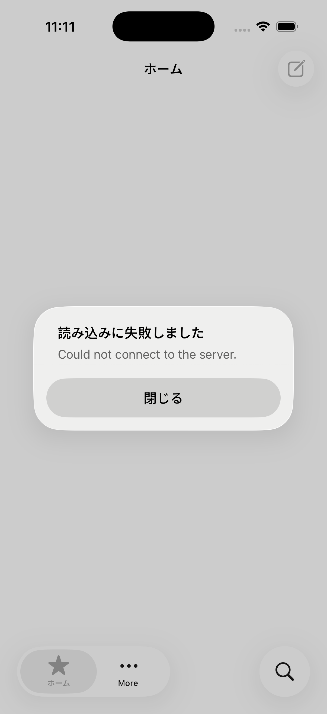

# X Relay Client



iOS 12以上で動作するUIKit製のXクライアントです。XのCookieやCSRFトークンはアプリに保存せず、`twitter-api-safe-relay` が開いたログイン済みブラウザのセッションを利用します。

## リリース

最新版は [GitHub Releases](https://github.com/s22123-create/twitter_api_safe_relay/releases) から取得できます。

配布IPAはActionsで生成した署名なしIPAです。Impactorなどで再署名する場合も、`Payload/XRelayClient.app` がIPA直下にある標準構造で生成されています。App Store配布や実機へのインストールには、Apple Developerの証明書・プロビジョニングプロファイルで再署名してください。Simulatorでの動作確認済みアプリは、同じReleaseのスクリーンショットとともに公開されます。

## 起動

1. ルートでリレーを起動します。

   ```sh
   pnpm install
   pnpm dev:relay
   ```

2. Xcodeで `ios/XRelayClient.xcodeproj` を開き、iOS 12以上の端末またはシミュレータを選択します。
3. アプリの「設定」でリレーURLを指定します。実機からMac上のリレーへ接続する場合は `http://MacのIPアドレス:3000` を指定してください。
4. リレー側のブラウザでXにログインします。

## 機能

- ホームタイムライン取得
- リクエストカタログを使ったキーワード検索
- テキストポスト
- 複数プロフィールの `x-profile-name` 切り替え
- iOS Simulatorでの起動確認とホーム画面スクリーンショット

queryIdやfeature flagはアプリに固定せず、リレーの `/requests.ndjson` から取得します。これにより、X Web App側の変更時にアプリを再配布せず、リレー側のカタログを更新できます。
